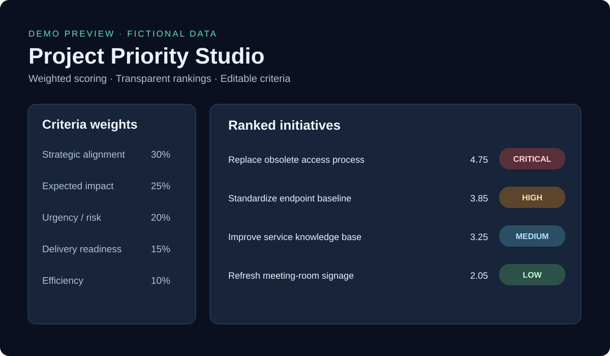

# Project Priority Studio

**A portable project prioritization scorecard** with configurable criteria and weights, weighted scores, ranked initiatives, and CSV export.

[Open the browser tool](./index.html) · [Methodology](./MODEL.md)

## Features

- Five editable 1–5 criteria with weights initially 30/25/20/15/10
- Validates weights total 100% and descending priority thresholds
- Scores and sorts multiple fictional/example initiatives
- Exports scored projects as CSV
- No backend, authentication, third-party scripts, or tracking
- Python reference implementation with unit tests

## Get started

Open `index.html` in any modern browser. Edit criteria and initiative ratings, then export CSV. For the command-line reference:

```bash
cd tools/priority-scoring
python scoring.py
python -m unittest -v test_scoring.py
```

## Transparency

The scoring weights reflect a general five-weight framework; **criterion labels and priority cutoffs here are configurable illustrative defaults**, not a claim of exact workplace policy. All example initiatives are fictitious.

## Screenshot



The graphic is a *mock preview*, not a screenshot captured from a production system.

## Limitations

Browser values reset on refresh; CSV export is one-way. No automatic approval, budget optimization, data retention, or security assessment is performed. For regulated or employer-specific use, apply your own governance and data-handling controls.
